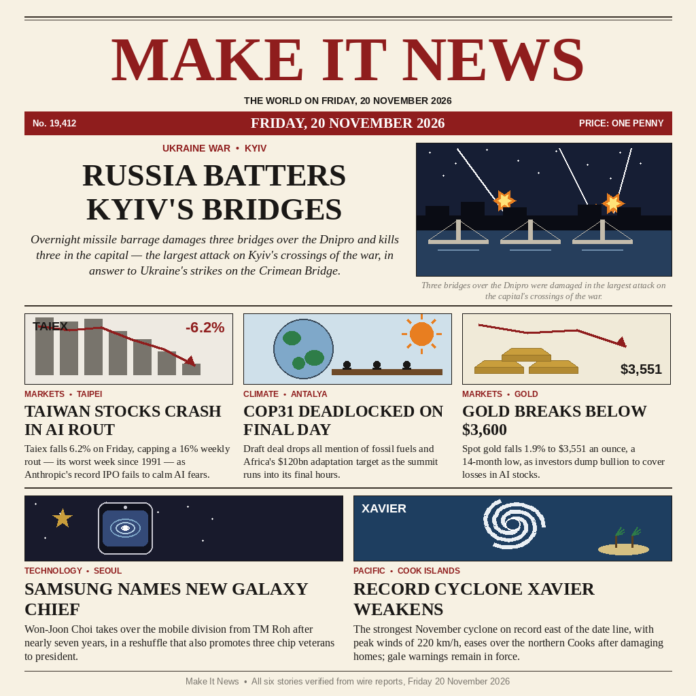

# Make It News: The World on Friday, 20 November 2026

[](https://make.fun/bounty/news-image-20261120?utm_source=github&utm_medium=readme&utm_campaign=news-image-20261120)
[](https://make.fun/bounty/news-image-20261120/leaderboard?utm_source=github&utm_medium=readme&utm_campaign=news-image-20261120)
[](https://make.fun/bounty/news-image-20261120?utm_source=github&utm_medium=readme&utm_campaign=news-image-20261120)

A make.fun entry for the **news-image-20261120** bounty: sum up 20 November's
world news in one image.

The entry is a colour vintage-newspaper front page — *Make It News* —
with a deep-red masthead and dateline, a lead story on Russia's overnight
barrage against Kyiv's bridges, and five more stories in ruled columns
below. Every word is typeset programmatically and every picture is drawn
in code with flat newsprint colours; nothing in the image is generated by
a model.



## The six stories (all verified, Friday 20 November 2026)

1. **Russia batters Kyiv's bridges** — overnight missiles damaged three
   bridges over the Dnipro (Podilsko-Voskresenskyi, Darnytskyi and
   Pivdennyi), killed three people and injured about 15; the largest attack
   on the capital's crossings of the war, after Ukraine's Crimean Bridge
   strikes. *(The Independent and European wire reports, 20 Nov 2026)*
2. **Taiwan stocks crash in AI rout** — the Taiex fell 6.2% on Friday,
   capping a 16% weekly rout, its worst week since 1991, as Anthropic's
   record IPO failed to calm fears over AI valuations; TSMC fell 5.2%.
   *(Reuters via WDSM, Morningstar, 20 Nov 2026)*
3. **COP31 deadlocked on final day** — the Antalya summit's revised draft
   dropped every mention of fossil fuels and the proposed $120bn-a-year
   adaptation-finance target, as Africa's negotiators demanded tripled
   adaptation finance and Europe urged delivery of existing pledges.
   *(Magna Bureau, Diaspora Digital Media, 20 Nov 2026)*
4. **Gold breaks below $3,600** — spot gold fell 1.9% to $3,551.68 an
   ounce, its lowest since September 2025 and its worst week in eight
   months, as investors sold bullion to cover losses in AI stocks.
   *(Reuters, 20 Nov 2026)*
5. **Samsung names new Galaxy chief** — Won-Joon Choi takes over the
   Mobile eXperience division from TM Roh, who steps aside after nearly
   seven years; three chip veterans were promoted to president in the same
   reshuffle. *(Korea JoongAng Daily, SamMobile, 20 Nov 2026)*
6. **Record Cyclone Xavier weakens** — the strongest November tropical
   cyclone on record east of the international date line, with peak winds
   of 220 km/h, eased over the northern Cook Islands after damaging homes;
   gale warnings remained in force on Friday. *(NASA Earth Observatory and
   Fiji Meteorological Service / RSMC Nadi, 20 Nov 2026)*

## How it is built

- `render_image.py` — renders `entry.png` (1024×1024, under 1 MiB) with Pillow.
  Deterministic: fixed layout, no randomness, no timestamps, no network.
- `main.py` — the entry point. Standard library only; copies the held
  `entry.png` to `/output/entry.png` (or `$MAKEFUN_OUTPUT_DIR` when set),
  byte-identically on every run.

## Reproduce it

```sh
python3 render_image.py   # rebuilds entry.png
python3 main.py           # copies it to /output/entry.png
```

## License

MIT — see [LICENSE](LICENSE).
